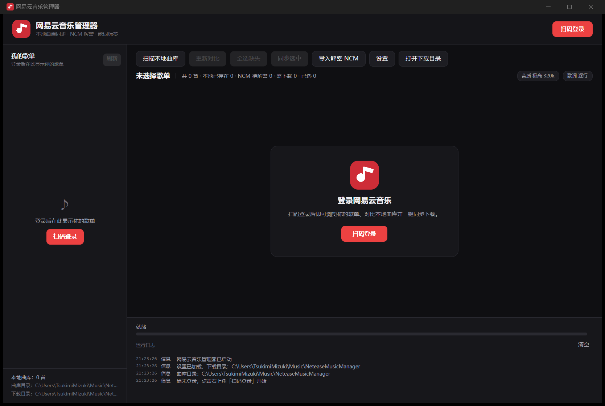

# 网易云音乐管理器（NeteaseMusicManager）

一个面向 Windows 的网易云音乐桌面工具：扫码登录后长期保持登录态，读取账号歌单，扫描本地曲库，
自动对比歌单与本地文件差异，按选定音质下载缺失歌曲，解密本地 NCM 文件，并把标题、歌手、专辑、
封面与逐行/逐字歌词写入音乐标签。

> 仅用于个人备份自己有权访问的音乐。请遵守网易云音乐用户协议与当地版权法律，不要分发下载内容。

## 功能

- **扫码登录 + 长期登录**：调用网易云官方扫码登录接口，成功后将 Cookie 使用 Windows DPAPI
  加密保存在本机，下次启动自动恢复登录态。
- **歌单浏览**：读取“我的歌单”、歌单详情与完整曲目（大歌单自动分批补齐）。
- **本地曲库对比**：扫描本地目录，按“网易云 ID / 标题+歌手+时长”自动匹配歌单曲目，
  在列表中标记“本地已存在 / NCM 待解密 / 需下载”。
- **按音质下载**：标准 128k、较高 192k、极高 320k、无损 FLAC、Hi-Res，可配置并发数、文件名模板、
  跳过或覆盖已有文件。下载完成后自动写入标签。
- **NCM 自动解密**：支持网易云客户端下载的 .ncm 文件，自动识别 MP3/FLAC、提取内嵌封面与元数据；
  对比结果中的 NCM 文件可直接一键解密并补充标签/歌词。在线接口返回的音频通常已是未加密格式，
  程序同样会检测 NCM 文件头，若实际拿到加密数据会自动解密。
- **歌词匹配**：自动拉取歌词与翻译，支持逐行 LRC 或逐字增强 LRC（原生 YRC 数据存在时），写入标签。
- **标签补全**：标题、歌手、专辑、专辑歌手、音轨号、年份、封面、网易云歌曲 ID。
- **可视化界面**：Avalonia 11 + MVVM，深色主题，支持进度、日志与错误提示；歌单侧栏可用顶栏按钮或 `Ctrl+B` 收起/展开。

## 界面



启动后：

1. 点击右上角 **扫码登录**，用网易云音乐 App 扫描窗口中的二维码并确认。
2. 登录成功后左侧显示歌单；点击歌单加载歌曲。
3. 在设置中选择下载目录、本地曲库目录、音质和歌词模式。
4. 点击 **扫描本地曲库**，再点击 **重新对比**；列表中会显示每首歌的本地状态。
5. 勾选需要的歌曲（或“全选缺失”），点击 **下载/同步选中**。
6. 已有的 .ncm 文件可在对比后直接走同步流程，也可使用 **导入/解密 NCM** 批量处理。

截图位于 [docs/screenshots/](docs/screenshots/)。

## 技术栈

- .NET 8 / C# 12
- Avalonia 11.3（Windows 桌面；Core 不依赖 UI，方便后续复用）
- CommunityToolkit.Mvvm
- TagLibSharp（音频标签）
- QRCoder（登录二维码）
- xUnit（Core 单元测试）

## 目录结构

```
NeteaseMusicManager.sln
src/
  NeteaseMusicManager.Core/        # 可复用的平台无关业务层（未来 Android 直接引用）
    Netease/                       # 登录、weapi 加密、歌单/歌曲/歌词 API
    Ncm/                           # NCM 解密
    Lyrics/                        # LRC / 增强 LRC / YRC 解析与序列化
    Tags/                          # 标签读写
    Library/                       # 本地扫描与匹配
    Download/                      # 下载、NCM 导入
    Sync/                          # 一键同步编排
    Storage/ Settings/ Models/     # 登录态、设置、领域模型
  NeteaseMusicManager.Desktop/     # Avalonia Windows 界面
tests/
  NeteaseMusicManager.Core.Tests/  # 单元测试（不依赖网络）
```

更详细的设计与后续 Android 复用说明见 [docs/ARCHITECTURE.md](docs/ARCHITECTURE.md)。

## 构建与运行

前置条件：Windows 10/11、.NET 8 SDK。仓库内提供了本地 SDK 时可直接使用 `build.ps1`。

```powershell
# 还原 + 构建（Debug）
.\build.ps1

# 运行
.\src\NeteaseMusicManager.Desktop\bin\Debug\net8.0\NeteaseMusicManager.exe

# 单元测试
.\build.ps1 -Test

# 发布 Windows x64 独立目录
.\build.ps1 -Publish
# 输出：publish\win-x64\NeteaseMusicManager.exe
# 自包含发布包：publish\NeteaseMusicManager-win-x64.zip
```

发布的 win-x64 版本已包含 .NET 运行时，解压后直接运行 `NeteaseMusicManager.exe` 即可，
目标机器不需要预装 .NET。

如果使用系统安装的 .NET 8 SDK，也可以：

```powershell
dotnet restore NeteaseMusicManager.sln
dotnet build NeteaseMusicManager.sln -c Release
dotnet test tests/NeteaseMusicManager.Core.Tests/NeteaseMusicManager.Core.Tests.csproj
```

## 数据与隐私

- 登录 Cookie：标准路径 `%LOCALAPPDATA%\NeteaseMusicManager\session.dat`（Windows DPAPI 当前用户加密）。
- 应用设置：标准路径 `%LOCALAPPDATA%\NeteaseMusicManager\settings.json`。
- 下载/解密文件：默认位于 `用户\音乐\NeteaseMusicManager`，可在设置中修改。
- **受限环境自动降级**：若进程没有权限写入 AppData/音乐目录（企业策略、沙箱、精简用户配置等），
  客户端会自动把数据目录切换到程序目录下的 `data`（便携模式），并在运行日志中提示；
  下载/曲库默认目录同时切换到 `data\Music`。也可用环境变量
  `NETEASE_MUSIC_MANAGER_DATA_DIR` 指定数据目录。
- 便携模式一旦启用（程序目录存在 `data`）会保持稳定，之后无论怎样启动都使用该目录；
  发布 zip **不包含** `data`，升级时保留/备份该目录即可保留登录态与设置。
- 程序不收集、不上传任何账号信息；所有网络请求直接发往网易云音乐官方域名。

## 已知限制

- 扫码登录 Cookie 不能通过刷新接口续期；若失效需要重新扫码。
- 无损/Hi-Res 取决于账号会员权益与歌曲版权；接口无权限时会回退或给出明确错误。
- 逐字歌词依赖网易云是否对该歌曲提供了 YRC 数据；没有时自动回退为逐行 LRC。
- 版权受限/下架歌曲无法下载（接口返回空 URL），程序会标记失败而不是绕过版权限制。
- 网易云接口非公开且可能变更；如遇接口失效，可在 Core/Netease 中调整端点。
- 当前版本定位为歌单同步/下载/解密/标签管理，不含本地播放器。

第三方组件与参考项目见 [THIRD_PARTY_NOTICES.md](THIRD_PARTY_NOTICES.md)。

## 开发状态与验证

- 解决方案 Debug/Release 构建通过，0 warning / 0 error。
- Core 单元测试 **170/170 通过**（API 61、NCM/歌词/标签 40、本地扫描/下载/同步 60、存储/设置/文件名 9）。
- 真实网络冒烟：匿名 weapi 歌单/详情/歌词/取链、二维码出码与轮询 801，以及一首免费歌曲的
  320k 下载 + 中文标签 + 封面 + 逐字歌词写入/读回全部通过。
- Avalonia 客户端已启动验证并截图（上方）；真实扫码登录已完成验证，且重启客户端后能自动恢复账号与歌单。
- 受限环境下自动切换到程序目录 `data` 的便携数据目录已验证，可正常保存登录 Cookie 和设置。
- NCM 解密使用合成 NCM 样本完成往返测试；未使用真实账号文件做版权内容验证。

详见 [docs/IMPLEMENTATION_STATUS.md](docs/IMPLEMENTATION_STATUS.md)。

## 后续 Android 计划

- Core 项目已通过接口隔离 UI 与 Windows 存储实现；Android 端可引用 Core，替换
  ISessionStore / 文件夹选择器 / 通知与后台任务实现后复用登录、歌单、下载、解密、标签与歌词逻辑。
- 下载目录/文件系统访问将改为 Android SAF 或应用私有目录。
